# Pytania laboratoryjne

## Pytanie 1 - Rola parametrów układu

### Wpływ masy, sztywności i współczynnika tłumienia

- Wpływ masy ($m$)
  - Wpływ na częstotliwość: Zwiększenie masy $m$ powoduje zmniejszenie częstotliwości drgań własnych ($\omega_0 = \sqrt{c/m}$) oraz wydłużenie okresu drgań. Ciężar porusza się "ciężej" i wolniej.
  - Wpływ na czas wygaszania: Przy stałym tłumieniu $k$, większa masa oznacza mniejszy względny wpływ tłumienia (współczynnik tłumienia $\zeta = k / 2\sqrt{mc}$ maleje), co sprawia, że drgania gasną wolniej, a układ dłużej powraca do stanu równowagi.
- Wpływ sztywności sprężyny ($c$)
  - Wpływ na częstotliwość: Zwiększenie sztywności $c$ zwiększa częstotliwość drgań własnych ($\omega_0 = \sqrt{c/m}$) i skraca okres drgań. Układ drga szybciej i bardziej energicznie.
  - Wpływ na dynamikę: Sztywniejsza sprężyna generuje większą siłę przywracającą, co sprawia, że masa szybciej dąży do powrotu do położenia równowagi. Wpływa to również na zmniejszenie względnego tłumienia ($\zeta$), przez co układ staje się bardziej podatny na oscylacje (jeśli tłumienie nie jest wysokie).
- Wpływ współczynnika tłumienia ($k$)
  - Wpływ na amplitudę: Nie zmienia częstotliwości drgań samego procesu oscylacyjnego, ale odpowiada za szybkość zaniku amplitudy w czasie (współczynnik gasnienia $\delta = k / 2m$).
  - Reżimy ruchu: Zmiana wartości $k$ całkowicie zmienia charakter powrotu do równowagi:
    - Ruch podkrytyczny ($k < 2\sqrt{mc}$): Układ oscyluje wokół położenia równowagi, a amplituda drgań stopniowo maleje wykładniczo aż do zera.
    - Ruch krytyczny ($k = 2\sqrt{mc}$): Układ powraca do stanu równowagi w najkrótszym możliwym czasie bez ani jednego przekroczenia (brak oscylacji).
    - Ruch nadkrytyczny ($k > 2\sqrt{mc}$): Układ powraca do równowagi bardzo powoli, "pełznąc" bez drgań, ze względu na bardzo silny opór ośrodka.

### 1. Wpływ masy na drgania

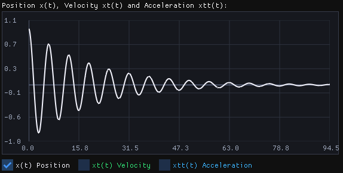
*Rys. 1. Układ bazowy $m = 1$, $c = 1$, $k = 1$: referencyjna odpowiedź oscylacyjna.*

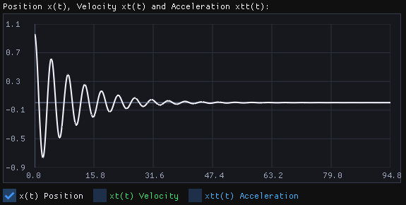
*Rys. 2. Układ o małej masie $m = 0{,}5$: drgania są szybsze, a okres krótszy.*

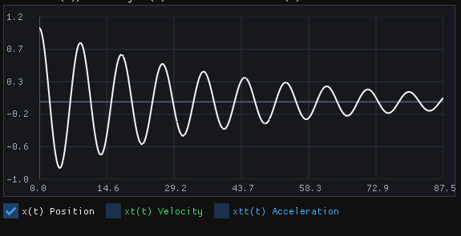
*Rys. 3. Układ o większej masie $m = 2$: drgania są wolniejsze, okres wydłuża się, amplituda zanika wolniej.*

### 2. Wpływ sztywności sprężyny

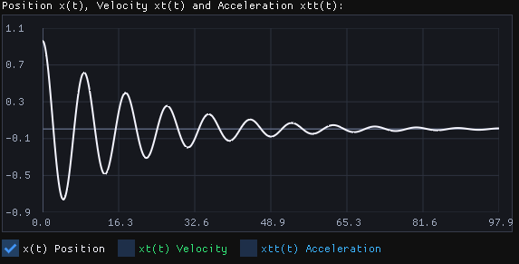
*Rys. 4. Mniejsza sztywność $c = 0.5$: siła przywracająca jest słabsza, więc ruch jest bardziej rozciągnięty w czasie.*

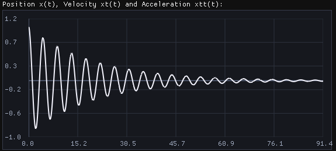
*Rys. 5. Większa sztywność $c = 2$: drgania są szybsze, a układ wraca do równowagi bardziej dynamicznie.*

### 3. Wpływ tłumienia

*Rys. 6. Duże tłumienie $k = 5$: amplituda zanika bardzo szybko, a układ wraca do stanu równowagi bez długotrwałych oscylacji.*

## Wykresy błędu dla różnych wartości kroku całkowania Δt

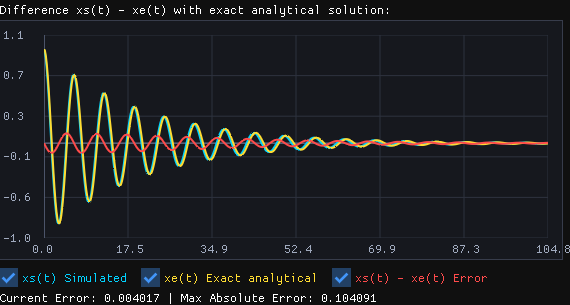
*Rys. 7. Dla $\Delta t = 0{,}2$*

*Rys. 7. Dla $\Delta t = 0{,}1$*

*Rys. 8. Dla $\Delta t = 0{,}05$*

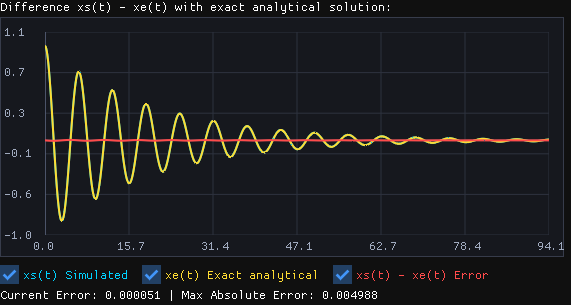
*Rys. 9. Dla $\Delta t = 0{,}01$*

### Wniosek dotyczący kroku całkowania

Im mniejszy krok czasu $\Delta t$, tym dokładniejsze jest rozwiązanie numeryczne. Wynika to z faktu, że metoda całkowania lepiej aproksymuje pochodne i zmniejsza błąd dyskretyzacji. W praktyce: przy dużym $\Delta t$ błędy kumulują się szybciej, a przebieg odchyla się od rozwiązania dokładnego.

## Pytanie 2 - Tłumienie krytyczne

Dla układu z $m = 1$ oraz $c = 1$ wartość tłumienia krytycznego wyraża się wzorem $k_{kr} = 2\sqrt{mc}$. Po podstawieniu danych otrzymujemy $k_{kr} = 2\sqrt{1\cdot 1} = 2$. Oznacza to, że przy $k = 2$ układ wraca do położenia równowagi w najkrótszym możliwym czasie bez oscylacji. Dla $k < 2$ mamy ruch podkrytyczny (oscylacyjny), natomiast dla $k > 2$ ruch nadkrytyczny (bez drgań, ale wolniejszy).

*Rys. 10. Dla $k = 0.5$ układ nadal oscyluje, co oznacza stan podkrytyczny.*

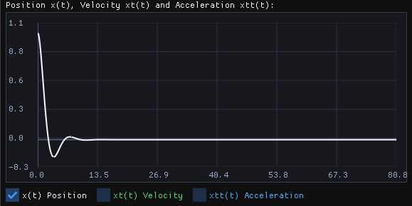
*Rys. 11. Dla $k = 1$ oscylacje są nadal widoczne, choć ich amplituda maleje szybciej niż przy mniejszym tłumieniu.*

*Rys. 12. Dla $k = 2$ układ znajduje się w stanie krytycznym — powrót do równowagi jest najszybszy bez przejścia przez zero.*

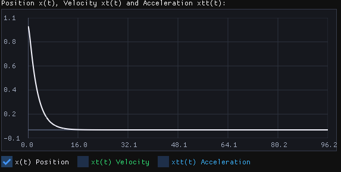
*Rys. 13. Dla $k = 3$ układ jest nadkrytyczny: brak oscylacji, lecz dojdzenie do równowagi jest wolniejsze niż dla $k = 2$.*

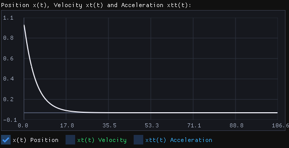
*Rys. 14. Dla $k = 5$ tłumienie jest bardzo duże, więc ruch jest monotoniczny i bardzo wolny.*

Na podstawie tych wykresów można stwierdzić, że tłumienie krytyczne dla $m = 1$ i $c = 1$ wynosi $k_{kr} = 2$.

## Pytanie 3 - Czas ustalania odpowiedzi skokowej

Dla $x(0)=0$, $v(0)=0$, $m=c=1$ i skoku $w(t)=f_2$ o amplitudzie $A=1$ położeniem równowagi jest $x=1$.

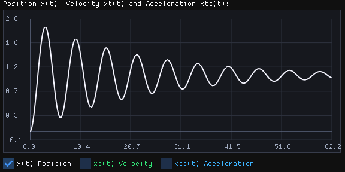
*Rys. 15. Małe tłumienie $k=0{,}1$: widoczne są długotrwałe oscylacje wokół położenia równowagi $x=1$.*

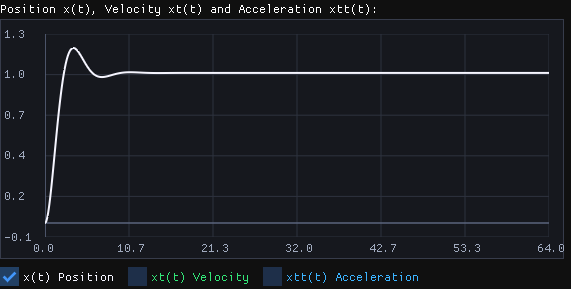
*Rys. 16. Dla $k=1$ oscylacje są mocniej tłumione, lecz nadal występuje wyraźne przeregulowanie.*

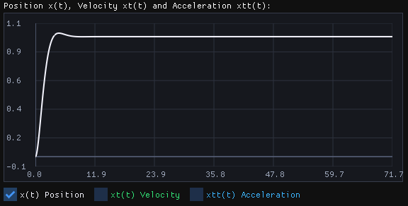
*Rys. 17. Dla $k=1{,}5$ przeregulowanie jest niewielkie, a odpowiedź szybko zbliża się do wartości końcowej; ten przypadek daje najkrótszy czas ustalania w badanym zakresie.*

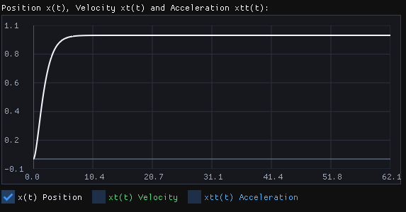
*Rys. 18. Dla tłumienia krytycznego $k=2$ odpowiedź dochodzi do równowagi bez oscylacji i przeregulowania.*

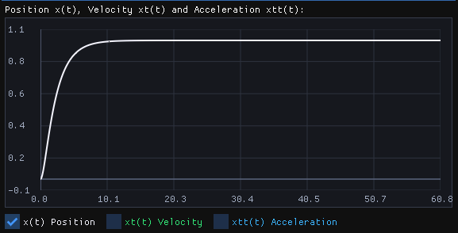
*Rys. 19. Dla $k=2{,}5$ układ jest nadkrytyczny: odpowiedź nie oscyluje, lecz ustala się wolniej.*

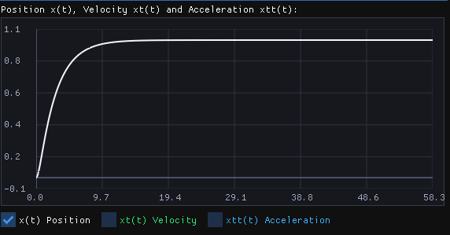
*Rys. 20. Dla $k=3$ nadmierne tłumienie jeszcze bardziej wydłuża dojście do położenia równowagi.*

Dodanie funkcji skokowej jako wymuszenia (ruchu podstawy) nie zmienia optymalnej wartości tłumienia.

## Pytanie 4 - Odpowiedź na wymuszenie prostokątne

Dla $x(0)=1$, $v(0)=0$, $m=c=1$ oraz $w(t)=f_3$ ($A=1$, $\varphi=0$) porównano przebiegi dla kilku wartości tłumienia. Nazwy plików kodują wartości $k$ w dziesiątych częściach: `k1` oznacza $k=0{,}1$, `k4` — $k=0{,}4$, `k10` — $k=1$, `k15` — $k=1{,}5$, a `k20` — $k=2$.

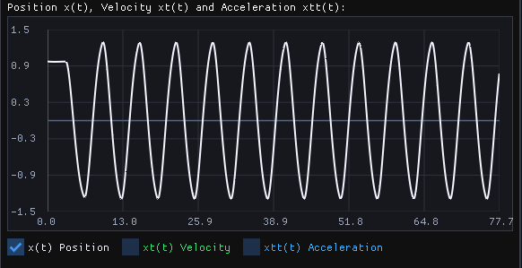
*Rys. 21. Dla $k=1$ położenie masy wykazuje duże, trwałe oscylacje.*

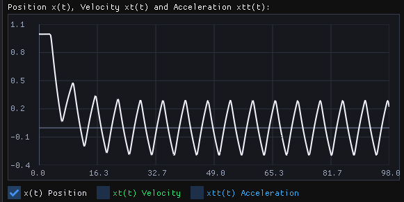
*Rys. 21. Dla $k=5$ położenie masy wykazuje duże, trwałe oscylacje.*

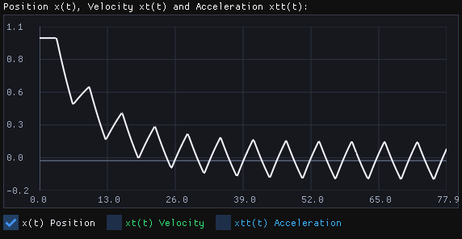
*Rys. 23. Dla $k=10$ amplituda ruchu jest mniejsza, ale przebieg nadal oscyluje pod wpływem powtarzanego wymuszenia.*

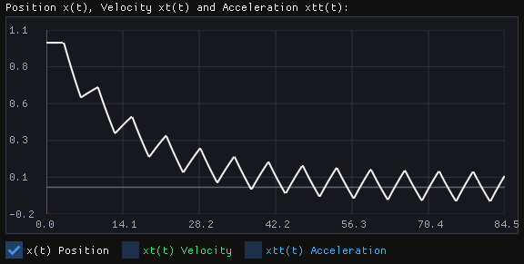
*Rys. 24. Dla $k=15$ oscylacje położenia mają mniejszą amplitudę niż przy słabszym tłumieniu.*

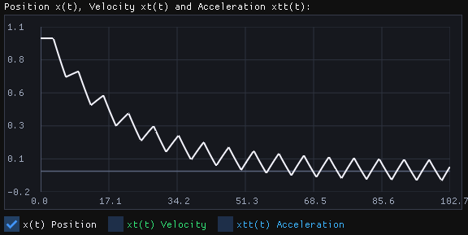
*Rys. 25. Dla $k=20$ amplituda położenia jest najmniejsza spośród pokazanych przypadków, lecz ruch nadal jest okresowy.*

Pliki graficzne pokazują położenie $x(t)$, prędkość i przyspieszenie; nie zawierają jednego wspólnego wykresu $x(t)$, $w(t)$ oraz $w(t)-x(t)$. Dla stale powtarzanego przebiegu prostokątnego warunek $|w(t)-x(t)|<0{,}1$ dla każdego $t>T$ nie może być spełniony: przy zmianie znaku $w(t)$ jego wartość skacze, podczas gdy położenie masy $x(t)$ jest ciągłe, więc błąd ponownie przekracza próg przy każdym przełączeniu. Można natomiast wyznaczyć czas zaniku stanu przejściowego, porównując kolejne okresy odpowiedzi, albo zmienić kryterium na błąd mierzony poza chwilami przełączeń.

## Pytanie 5 - Charakterystyka częstotliwościowa

Dla $x(0)=1$, $v(0)=0$, $m=c=A_0=1$, $\varphi_0=0$ oraz wymuszenia $w(t)=A_0\sin(\omega t+\varphi_0)$ równanie ruchu ma postać

$$
\ddot{x}+k\dot{x}+x=\sin(\omega t).
$$

Po zaniku składowej przejściowej odpowiedź ustalona również jest sinusoidalna:

$$
x_{ust}(t)=A(\omega)\sin\bigl(\omega t+\varphi(\omega)\bigr).
$$

Transmitancja układu dla wymuszenia harmonicznego wynosi

$$
H(i\omega)=\frac{X}{W}=\frac{1}{1-\omega^2+i k\omega}.
$$

Z jej modułu i argumentu otrzymujemy zależności amplitudy oraz fazy:

$$
A(\omega)=\frac{1}{\sqrt{(1-\omega^2)^2+(k\omega)^2}},
\qquad
\varphi(\omega)=-\operatorname{atan2}(k\omega,\,1-\omega^2).
$$

Faza jest podana w radianach względem fazy wymuszenia ($\varphi_0=0$); znak ujemny oznacza opóźnienie położenia masy. Warunki początkowe wpływają na przebieg przejściowy, ale nie na powyższą odpowiedź ustaloną.

Dla $k<\sqrt{2}$ maksimum amplitudy występuje przy

$$
\omega_r=\sqrt{1-\frac{k^2}{2}},
\qquad
A(\omega_r)=\frac{1}{k\sqrt{1-\frac{k^2}{4}}}.
$$

| $k$ | $\omega_r$ [rad/s] | $A(\omega_r)$ |
|---:|---:|---:|
| 0,1 | 0,9975 | 10,0125 |
| 0,5 | 0,9354 | 2,0656 |
| 1 | 0,7071 | 1,1547 |

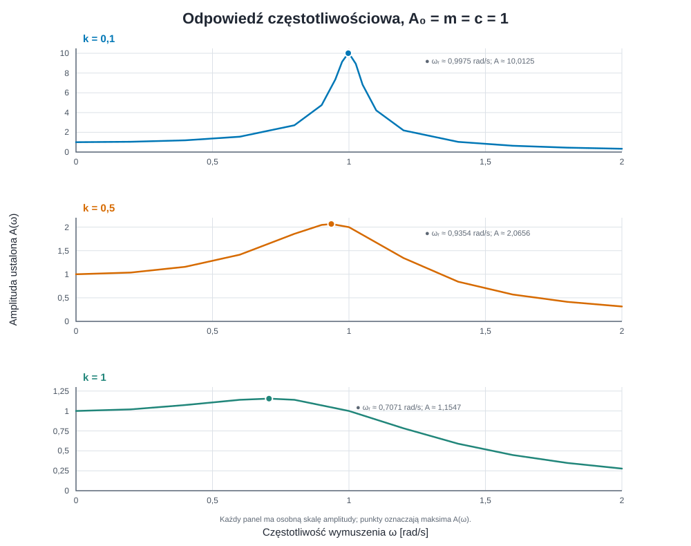
*Rys. 26. Amplituda odpowiedzi ustalonej w funkcji częstotliwości wymuszenia. Każdy panel ma osobną skalę amplitudy; zaznaczone punkty wskazują częstotliwości rezonansowe.*

Zależność maksymalnej amplitudy rezonansowej od tłumienia wynosi

$$
A(\omega_r)(k)=\frac{1}{k\sqrt{1-\frac{k^2}{4}}},
\qquad 0<k\leq\sqrt{2}.
$$

Gdy $k\to 0^+$, amplituda rezonansowa rośnie bez ograniczeń. Przy $k=\sqrt{2}$ częstotliwość rezonansowa spada do zera, a maksimum wynosi $A=1$. Dla $k>\sqrt{2}$ nie występuje już niezerowa częstotliwość rezonansowa; maksimum charakterystyki amplitudowej przypada na $\omega=0$.

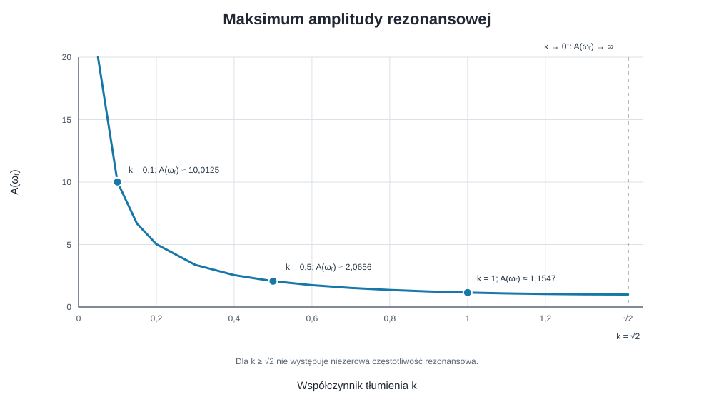
*Rys. 27. Maksymalna amplituda $A(\omega_r)$ w zależności od tłumienia $k$ dla $m=c=A_0=1$.*

## Pytanie 6 - Optymalna trajektoria ruchu masy i funkcja sterująca $w(t)$

### 1. Wyznaczenie optymalnej trajektorii ruchu masy

Dla dowolnego czasu $t \in [0, \frac{T}{2}]$ prędkość możemy zapisać jako całkę z przyspieszenia od chwili startu ($v(0)=0$). Korzystając z założenia $x_{tt}(\tau) \le 1$:
$$v(t) = v(0) + \int_0^t x_{tt}(\tau)\,d\tau \le \int_0^t 1\,d\tau = t$$

Z kolei dla drugiej połowy ruchu, czyli $t \in [\frac{T}{2}, T]$, wiemy, że prędkość końcowa musi wynosić $v(T) = 0$. Korzystając z dolnego ograniczenia $x_{tt}(\tau) \ge -1$:
$$0 = v(T) = v(t) + \int_t^T x_{tt}(\tau)\,d\tau \ge v(t) + \int_t^T (-1)\,d\tau = v(t) - (T - t)$$

Stąd dla drugiej połowy czasu zawsze zachodzi:
$$v(t) \le T - t$$

Teraz obliczamy całkowitą drogę $x(T) - x(0) = 1$, dzieląc całkę z prędkości na dwie części:
$$1 = \int_0^T v(t)\,dt = \int_0^{T/2} v(t)\,dt + \int_{T/2}^T v(t)\,dt$$

Wstawiając wyprowadzone wyżej nierówności:
$$1 \le \int_0^{T/2} t\,dt + \int_{T/2}^T (T - t)\,dt = \left[\frac{1}{2}t^2\right]_0^{T/2} + \left[-\frac{1}{2}(T-t)^2\right]_{T/2}^T = \frac{T^2}{8} + \frac{T^2}{8} = \frac{T^2}{4}$$

Otrzymujemy $1 \le \frac{T^2}{4}$, co daje $T \ge 2$.

Ponieważ w całkach użyliśmy słabych nierówności, minimalną wartość $T = 2$ można osiągnąć wtedy i tylko wtedy, gdy nierówności przechodzą w równości w każdym punkcie przedziału – czyli gdy $x_{tt}(t) = 1$ dla $t \in (0, 1)$ oraz $x_{tt}(t) = -1$ dla $t \in (1, 2)$.

---

### 2. Wyznaczenie szukanej funkcji przemieszczenia $w(t)$

Zakładając brak zewnętrznego pola siłowego, czyli $h(t) = 0$, równanie ruchu ma postać:
$$m \cdot x_{tt} = c \cdot (w - x) - k \cdot x_t$$

Przekształcając to równanie względem $w(t)$, otrzymujemy funkcję sterującą:
$$w(t) = x(t) + \frac{m \cdot x_{tt}(t) + k \cdot x_t(t)}{c}$$

Podstawiając wyznaczone wcześniej funkcje $x(t)$, $x_t(t)$ oraz $x_{tt}(t)$ dla poszczególnych przedziałów czasowych, otrzymujemy ostateczny wzór na $w(t)$:
$$w(t) = \begin{cases} 
\frac{1}{2}t^2 + \frac{k}{c}t + \frac{m}{c} & \text{dla } 0 \le t < 1 \\ 
1 - \frac{1}{2}(2 - t)^2 + \frac{k}{c}(2 - t) - \frac{m}{c} & \text{dla } 1 \le t \le 2 \\ 
1 & \text{dla } t > 2 
\end{cases}$$

---

### 3. Przypadek dla parametrów $m = 1, c = 1$

Przyjmując parametry $m = 1$ oraz $c = 1$, wzór upraszcza się do postaci:
- Dla $0 \le t < 1$:
  $$w(t) = \frac{1}{2}t^2 + k \cdot t + 1$$
- Dla $1 \le t \le 2$:
  $$w(t) = -\frac{1}{2}t^2 + (2 - k)t + 2k - 2$$
- Dla $t > 2$:
  $$w(t) = 1$$