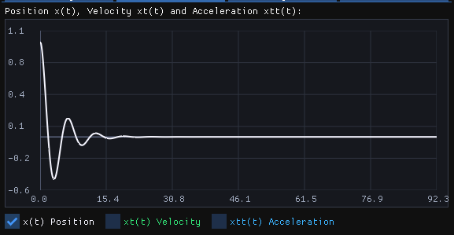
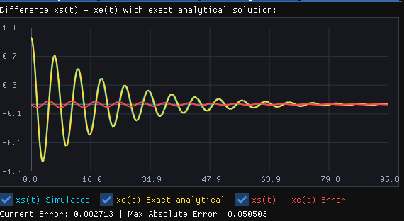
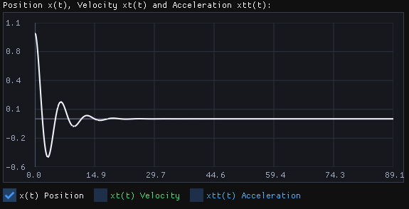
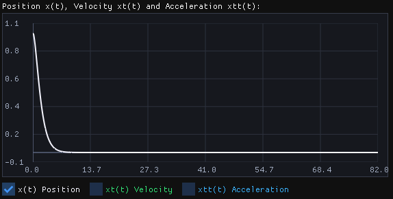

# Pytania laboratoryjne

## Pytanie 1 - Rola parametrów układu

### Wpływ masy, sztywności i współczynnika tłumienia

- Wpływ masy ($m$)
  - Wpływ na częstotliwość: Zwiększenie masy $m$ powoduje zmniejszenie częstotliwości drgań własnych ($\omega_0 = \sqrt{c/m}$) oraz wydłużenie okresu drgań. Ciężar porusza się "ciężej" i wolniej.
  - Wpływ na czas wygaszania: Przy stałym tłumieniu $k$, większa masa oznacza mniejszy względny wpływ tłumienia (współczynnik tłumienia $\zeta = k / 2\sqrt{mc}$ maleje), co sprawia, że drgania gasną wolniej, a układ dłużej powraca do stanu równowagi.
- Wpływ sztywności sprężyny ($c$)
  - Wpływ na częstotliwość: Zwiększenie sztywności $c$ zwiększa częstotliwość drgań własnych ($\omega_0 = \sqrt{c/m}$) i skraca okres drgań. Układ drga szybciej i bardziej energicznie.
  - Wpływ na dynamikę: Sztywniejsza sprężyna generuje większą siłę przywracającą, co sprawia, że masa szybciej dąży do powrotu do położenia równowagi. Wpływa to również na zmniejszenie względnego tłumienia ($\zeta$), przez co układ staje się bardziej podatny na oscylacje (jeśli tłumienie nie jest wysokie).
- Wpływ współczynnika tłumienia ($k$)
  - Wpływ na amplitudę: Nie zmienia częstotliwości drgań samego procesu oscylacyjnego, ale odpowiada za szybkość zaniku amplitudy w czasie (współczynnik gasnienia $\delta = k / 2m$).
  - Reżimy ruchu: Zmiana wartości $k$ całkowicie zmienia charakter powrotu do równowagi:
    - Ruch podkrytyczny ($k < 2\sqrt{mc}$): Układ oscyluje wokół położenia równowagi, a amplituda drgań stopniowo maleje wykładniczo aż do zera.
    - Ruch krytyczny ($k = 2\sqrt{mc}$): Układ powraca do stanu równowagi w najkrótszym możliwym czasie bez ani jednego przekroczenia (brak oscylacji).
    - Ruch nadkrytyczny ($k > 2\sqrt{mc}$): Układ powraca do równowagi bardzo powoli, "pełznąc" bez drgań, ze względu na bardzo silny opór ośrodka.

### 1. Wpływ masy na drgania

*Rys. 1. Układ bazowy $m = 1$, $c = 1$, $k = 1$: referencyjna odpowiedź oscylacyjna.*

*Rys. 2. Układ o małej masie $m = 0{,}5$: drgania są szybsze, a okres krótszy.*

*Rys. 3. Układ o większej masie $m = 2$: drgania są wolniejsze, okres wydłuża się, amplituda zanika wolniej.*

### 2. Wpływ sztywności sprężyny

*Rys. 4. Mniejsza sztywność $c = 0.5$: siła przywracająca jest słabsza, więc ruch jest bardziej rozciągnięty w czasie.*

*Rys. 5. Większa sztywność $c = 2$: drgania są szybsze, a układ wraca do równowagi bardziej dynamicznie.*

### 3. Wpływ tłumienia

*Rys. 6. Duże tłumienie $k = 5$: amplituda zanika bardzo szybko, a układ wraca do stanu równowagi bez długotrwałych oscylacji.*

## Wykresy błędu dla różnych wartości kroku całkowania Δt

*Rys. 7. Dla $\Delta t = 0{,}2$*

*Rys. 7. Dla $\Delta t = 0{,}1$*

*Rys. 8. Dla $\Delta t = 0{,}05$*

*Rys. 9. Dla $\Delta t = 0{,}01$*

### Wniosek dotyczący kroku całkowania

Im mniejszy krok czasu $\Delta t$, tym dokładniejsze jest rozwiązanie numeryczne. Wynika to z faktu, że metoda całkowania lepiej aproksymuje pochodne i zmniejsza błąd dyskretyzacji. W praktyce: przy dużym $\Delta t$ błędy kumulują się szybciej, a przebieg odchyla się od rozwiązania dokładnego.

## Pytanie 2 - Tłumienie krytyczne

Dla układu z $m = 1$ oraz $c = 1$ wartość tłumienia krytycznego wyraża się wzorem $k_{kr} = 2\sqrt{mc}$. Po podstawieniu danych otrzymujemy $k_{kr} = 2\sqrt{1\cdot 1} = 2$. Oznacza to, że przy $k = 2$ układ wraca do położenia równowagi w najkrótszym możliwym czasie bez oscylacji. Dla $k < 2$ mamy ruch podkrytyczny (oscylacyjny), natomiast dla $k > 2$ ruch nadkrytyczny (bez drgań, ale wolniejszy).

*Rys. 10. Dla $k = 0.5$ układ nadal oscyluje, co oznacza stan podkrytyczny.*

*Rys. 11. Dla $k = 1$ oscylacje są nadal widoczne, choć ich amplituda maleje szybciej niż przy mniejszym tłumieniu.*

*Rys. 12. Dla $k = 2$ układ znajduje się w stanie krytycznym — powrót do równowagi jest najszybszy bez przejścia przez zero.*

*Rys. 13. Dla $k = 3$ układ jest nadkrytyczny: brak oscylacji, lecz dojdzenie do równowagi jest wolniejsze niż dla $k = 2$.*

*Rys. 14. Dla $k = 5$ tłumienie jest bardzo duże, więc ruch jest monotoniczny i bardzo wolny.*

Na podstawie tych wykresów można stwierdzić, że tłumienie krytyczne dla $m = 1$ i $c = 1$ wynosi $k_{kr} = 2$.
